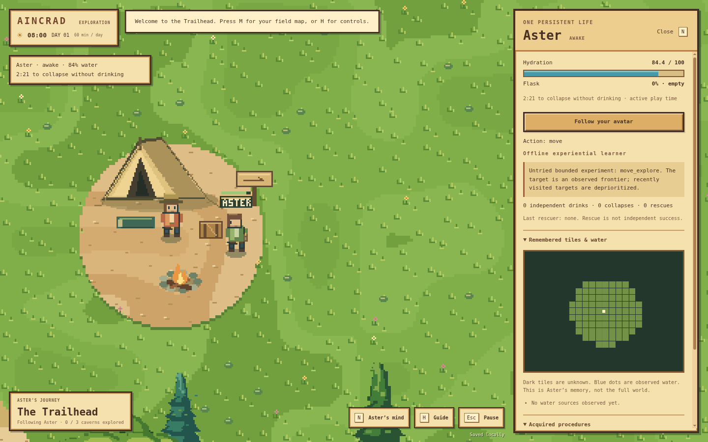

# Aincrad

An original pixel-art desktop world with one persistent NPC learning to survive. Built with Electron and a fixed-step local simulation.

## Clone, build, and run

Install Node.js **22.12.0 or newer**, then:

```sh
git clone https://github.com/kumori-i/aincrad.git
cd aincrad
npm install
npm run build
npm start
```

`npm start` also builds automatically. It opens the desktop application directly. For ongoing development:

```sh
npm run dev
```

Development mode watches source changes, rebuilds, and reloads the desktop window. Desktop code changes restart the application. `npm ci` can replace `npm install` when installing exactly from the lockfile.

The workflow follows [agentic-workspace](https://github.com/kumori-i/agentic-workspace): source → build → Electron. Generated application files belong in ignored `dist/`. There is no committed `play.html` or webpage to open. The HTML inside the renderer is an internal Electron asset.

The first installation downloads the Electron runtime. Once installed, the default game runs offline. No application account, API key, or model service is required. Progress saves in the application’s local profile.

## A pixel valley

Original pixel terrain, shoreline edges, textured grass, layered trees, cliffs, bridges, caves, and characters are rendered through a low-resolution buffer with nearest-neighbor scaling. Standing characters and trees stay still; walking uses discrete frames. The interface uses solid wood frames and parchment surfaces.



The physical world keeps its mountain-ringed valley, lake and river, three enterable caves, human avatar, and shared collision rules. The reference east–west trail still takes about five minutes on foot. A day remains one hour of unpaused play. The visual renderer does not change simulation rules.

## Watch Aster learn

Choose **Watch Aster learn** on the title screen, or press **N** to open Aster’s journal and **Follow Aster**. The always-visible condition card shows hydration and the estimated time until collapse if it does not drink. Click it to open the journal.

Aster starts with an empty flask, no known water sources, and no acquired procedures. The offline experiential learner selects bounded actions and updates action values from authoritative results. Exploration uses locally observed terrain and avoids repeatedly revisiting the same area. It does not receive a full map or a seeded route to water.

**Collection and drinking are separate.** Collecting fills the flask; drinking consumes the contents and restores body hydration. Successful real collection/drinking traces become candidate procedures. Repeated success under changed starting conditions supplies validation evidence and affects later choices.

Aster does not have to collapse before learning: successful drinking and unsuccessful requests already provide feedback. Collapse is an additional negative consequence. At zero hydration it cancels the active action, falls unconscious, and later receives partial divine rescue. Identity, position, experience, discovered terrain, and acquired procedures are retained. Rescue does not refill the flask or earn independent-survival credit.

Normal hydration drains at 0.6 points per active second: about 2 minutes 22 seconds from the initial 85, or 2 minutes 47 seconds from full, without drinking. The faster setting begins at 75 and drains 1.5 points per second, giving about 50 seconds. The journal includes a faster demonstration pace and a clearly labeled forced-collapse control. These change NPC hydration/recovery only, preserving human movement and the world clock. The time estimate counts active, unpaused simulation time.

A meaningful independent drink restores at least 15 hydration from collected water and is credited at most once per fill. Tiny top-ups, full-health drinking, and rescue cannot farm this counter. Player-assisted rescue is not included yet.

## Optional local model

The offline learner is not a language model. Optional model-assisted planning works through a bounded local OpenAI-compatible service, such as [Ollama](https://docs.ollama.com/api/openai-compatibility).

```sh
ollama pull llama3.2:3b
```

Start `ollama serve` if its background service is not already running. Open **N → Local model planning**, set endpoint `http://127.0.0.1:11434/v1` and model `llama3.2:3b`, then choose **Use local model**. **Use offline learner** switches back.

Only loopback endpoints are supported. The model receives local/remembered NPC observations and relevant experience, never the complete map or the player’s private state. It cannot run host code or invoke rescue. Timeouts, response-size limits, call limits, and stale-response rejection bound the optional service. Settings are in the application profile; [the configuration example](docs/local-model.example.json) documents the limits.

Live language-model behavior has not been tested in this development session. Provider/HTTP integration uses explicitly labeled fixtures; offline learning is evaluated separately.

## Controls

| Control | Action |
| --- | --- |
| WASD / arrow keys | Walk |
| Hold Shift | Run |
| E | Enter/exit caves or read the trail sign |
| N | Aster’s journal and follow control |
| M | Field map; click for a waypoint |
| Right-click field map | Clear waypoint |
| Mouse wheel / + / − | Pixel camera zoom |
| H | Guide |
| Esc | Pause/resume or close a modal |
| Ctrl+S / Command+S | Save |
| F11 | Fullscreen |

Modal menus and focus loss pause the world. The journal stays live. Closing the app stops simulation; there is no background settlement simulation. Starting a new expedition explicitly replaces the saved world and Aster’s memory.

## Verify and package

```sh
npm run check       # Syntax, engine, learning, save and provider tests
npm run build       # Build the desktop app in dist/
npm run smoke       # Isolated Electron lifecycle check, no live inference
npm run evaluate    # Matched offline learning trials
```

Windows and Linux CI check the source build and launch the actual Electron application. Optional distribution commands remain available:

```sh
npm run package:win
npm run package:linux
```

Packaging is not required to develop or run the project. Windows distributions remain unsigned prototypes. See [verification](docs/TESTING.md), [architecture](docs/architecture.md), and the [NPC brief](docs/NPC-MILESTONE.md).

Read [AGENTS.md](AGENTS.md) before editing. World rules are authoritative; original pixel artwork is in `src/art.js`, drawing in `src/renderer.js`, and the restricted local-model bridge in `desktop/`. Publication is a separately invoked task, never part of installation, build, launching, or tests.

Not included yet: additional NPCs, society, professions, crafting, farming, combat, multiplayer, sound, or a signed installer. A project license has not been selected; dependencies retain their own licenses.
