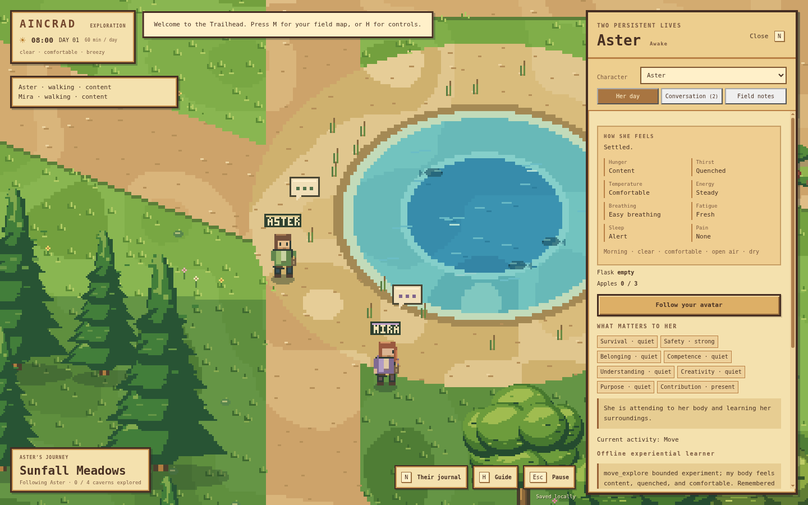

# Aincrad

An original pixel-art desktop world with two persistent characters, **Aster and Mira**, learning to care for their bodies, prepare for exploration and share what they discover. Built with Electron and a fixed-step local simulation.

## Clone, build, and run

Install Node.js **22.12.0 or newer**, then:

```sh
git clone https://github.com/kumori-i/aincrad.git
cd aincrad
npm install
npm run build
npm start
```

`npm start` also builds automatically and opens the desktop application. For ongoing development:

```sh
npm run dev
```

Development mode watches source changes, rebuilds and reloads the desktop window. Desktop code changes restart the application. Use `npm ci` instead of `npm install` to install exactly from the lockfile.

The workflow follows [agentic-workspace](https://github.com/kumori-i/agentic-workspace): source → build → Electron. Generated files belong in ignored `dist/`. The renderer's HTML is an internal application asset; there is no webpage to open or deploy.

The first installation downloads Electron. Once installed, the default game runs offline without an account, API key or model service. Progress saves in the application's local profile.

## A pixel valley

Original pixel terrain, shoreline edges, layered trees, cliffs, bridges, caves and characters use a low-resolution buffer with nearest-neighbor scaling. Idle characters and trees stay still; walking uses discrete frames. The interface uses wood frames and parchment surfaces.



The mountain-ringed valley preserves its lake, river, human avatar, five-minute reference crossing and one-hour day. Six smaller ponds, nine finite apple patches and four enterable caves include nearby **Willow Refuge**, roughly a 23-second walk along the habitat trail.

The shared saved clock drives daylight, seeded clear/cloudy/rainy/windy weather and food renewal. The daily base temperature peaks around 14:00 and is coolest around 04:00; wind, rain, shade and wetness affect felt temperature. Caves provide temperate shelter. Animals, fish and flowers are ambient scenery. Apples are usable food; hunting and fishing are later work. Drawing never advances these rules.

## Two bodies, two perspectives

Press **N** to open the journal. Select Aster or Mira to see her day, motives, current intention and remembered places, or follow her through the valley and caves. Each character has her own body, inventory, learned values, procedures, beliefs and plans. They share physical resources and world time, so an apple gathered by one is no longer available to the other.

New expeditions place both characters beside locally observable water. They begin with empty flasks, no carried apples and no acquired procedures. Existing saves preserve Aster's identity, memory and water procedures and add Mira as an independent character. Neither receives a complete map or the other's private memories.

The ordinary journal and model observations describe **sensations**, rather than percentages: peckish or ravenous, a dry mouth or parched, fresh or weary, easy breathing or winded, alert or sleepy. Weather is experienced as warm, cold, calm or gusty. Accumulating heat or cold produces distinct warning sensations—overheated or shivering—even after reaching shelter. A separate development checkbox exposes exact engine physiology for tuning.

The engine retains distinct, tunable stores:

| Body system | What changes it |
| --- | --- |
| Nourishment and hydration | Time and exposure consume reserves; gathered apples and water replenish them. Food is the more frequent gameplay need. |
| Energy | Activity spends it; adequate food, meals and recovery sustain it. |
| Stamina | Walking spends it; pausing and rest restore it. Exhaustion slows movement. |
| Fatigue | Wakefulness and activity accumulate it; rest and especially sleep relieve it. |
| Sleep pressure | Time awake raises it; sleep reduces it. |
| Thermal strain, wetness and health | Exposure has physical consequences; comfortable shelter permits recovery. Severe deprivation or strain damages health. |

Rest and sleep are actual timed actions. Food, water and exposure continue changing during them; unsafe conditions interrupt recovery. These are game-body systems, not a medical simulation or a human neural network.

Gathering and consumption remain separate. A character can carry three apples and a separate flask. Patches have finite stock, and remembered availability becomes stale. Characters can observe that apples returned and form a tentative expectation; they do not receive the hidden renewal timer.

Warning and critical discomfort create continuous learning costs before collapse, including during travel, waiting and model inference. Useful relief credits real prerequisite actions. Collapse and partial divine rescue remain a fallback, retaining identity and knowledge without granting carried supplies or independent-survival credit.

## Motives, beliefs and plans

Version 0.5 adds concurrent **Maslow-inspired drives**: survival, safety, belonging, competence, understanding, creativity, purpose and contribution. Their tensions change with bodily sensations, supplies, contact, failures, discoveries and active intentions. Survival can interrupt a trip or conversation. Curiosity does not require a rigid sequence of completed social levels.

Characters retain bounded beliefs with evidence and confidence. Direct observations, hypotheses and reports have different status. A peer's advice or your message is testimony to check, not instant world truth. A claim cannot create a discovered resource, replenish apples or certify a route.

Plans connect three to six validated actions to a goal. The offline controller supplies preparation and exploration templates: carry food and water, investigate a reachable edge of remembered terrain, observe, and return. A known return route and travel budget constrain these trips. Actual travel outcomes refine travel estimates. Failed steps, worsening sensations and expired budgets interrupt plans; saying what one intends to do never completes it.

The offline experiential learner updates bounded contextual and feature values from actual engine outcomes. Useful traces are recognized by supplied water, food and shelter procedure templates. Physiology, sensations, drives, navigation, dialogue and planning templates are **provided structure**; discovered resources, successful outcomes, learned action values and validated procedures depend on experience. This is not learning from a blank slate, arbitrary code invention or proof of emergent civilization.

## Conversation and field notes

Open **N → Conversation** to join the always-available journal room. Send a message to Aster, Mira or both. You may answer immediately, later, or leave a question unanswered. The characters continue their own activities and care for themselves. Pending-question and topic limits prevent repeated requests from becoming a waiting loop.

Aster and Mira can speak to one another when they are nearby, in the same scene and within line of sight. These exchanges appear in the journal and build familiarity. Seeing a peer reveals visible appearance, not hidden reserves or private memory. Reports remain unverified until checked against the recipient's observations.

The offline controller uses explicitly supplied, evidence-based dialogue templates. It can share a discovered resource and ask about a relevant uncertainty. A configured language model can compose language and propose plans through the same validated actions. The UI distinguishes offline dialogue from model-generated messages.

Characters can write persistent field notes at their locations and read notes they encounter. Notes preserve authorship and optional belief references. Reading another author's note supplies reported knowledge; writing a claim changes no physical world rules. The journal lets you inspect the notes without granting every character remote access to their contents.

## Optional local model

The offline learner is not a language model. Optional planning and conversation use a bounded local OpenAI-compatible service, such as [Ollama](https://docs.ollama.com/api/openai-compatibility).

```sh
ollama pull llama3.2:3b
```

Start `ollama serve` if its background service is not already running. Open **N → Her day → Local model planning**, set endpoint `http://127.0.0.1:11434/v1` and model `llama3.2:3b`, then choose **Use local model**. This setting serves both characters; **Use offline learner** switches back. The model name is an example, not a validated performance recommendation.

Only loopback endpoints are supported. Requests contain each character's qualitative sensations, local/remembered places, relevant experience, motives, beliefs, plans and available conversations. They exclude exact body stores, another character's private state, the full map and hidden renewal schedule. A shared request queue and call budget bound model use; cancellation is scoped to the affected character. Timeouts, stale responses and service failures return control to the offline learner.

The model cannot run host code, execute a save, assign physical outcomes or invoke rescue. Settings live in the application profile; [the configuration example](docs/local-model.example.json) documents limits. Ollama models bring pretrained knowledge and biases. Aincrad updates gameplay memory and values, **not model weights**.

Live model performance depends on the installed model and is distinct from deterministic provider fixtures and offline evaluation. See [TESTING.md](docs/TESTING.md) for the current verification record and its limits.

## Controls

| Control | Action |
| --- | --- |
| WASD / arrow keys | Walk |
| Hold Shift | Run your avatar |
| E | Enter/exit caves or read the trail sign |
| N | Character journal, follow controls and conversation |
| M | Field map; click for a waypoint |
| Right-click field map | Clear waypoint |
| Mouse wheel / + / − | Pixel camera zoom |
| H | Guide |
| Esc | Pause/resume or close a modal |
| Ctrl+S / Command+S | Save |
| F11 | Fullscreen |

Modal menus and focus loss pause the world. The journal stays live. Closing the app stops simulation; there is no wall-clock progression while closed. Starting a new expedition explicitly replaces the saved world and both characters' memories.

## Verify and package

```sh
npm run check       # Syntax, engine, learning, save and provider tests
npm run build       # Build the desktop app in dist/
npm run smoke       # Isolated Electron lifecycle check
npm run evaluate    # Offline evaluation; see its stated scenarios and duration
```

Windows and Linux CI check the source build and launch the actual Electron application. Optional distribution commands remain available:

```sh
npm run package:win
npm run package:linux
```

Packaging is not required to run or develop the project. Windows distributions remain unsigned prototypes. Read [AGENTS.md](AGENTS.md) before editing, and see [architecture](docs/architecture.md), [roadmap](docs/ROADMAP.md) and [verification](docs/TESTING.md). Publication is a separately invoked task, never part of installation, launch or tests.

The motivational design draws on [AgentCiv's Maslow Machines](https://github.com/agentciv/agentciv/blob/main/paper/maslow_machines.md), persistent knowledge artifacts on [TerraLingua](https://github.com/cognizant-ai-lab/terralingua), and embodied motivation on [MicroPsi](https://github.com/joschabach/micropsi2). Aincrad's implementation is original; these are conceptual references, not included source code or evidence that their results transfer to this game.

Construction, reproduction, professions, larger societies, farming, combat, multiplayer and sound remain outside this milestone. Long-term self-sufficiency and open-ended social behavior need further evaluation. A project license has not been selected; dependencies retain their own licenses.
