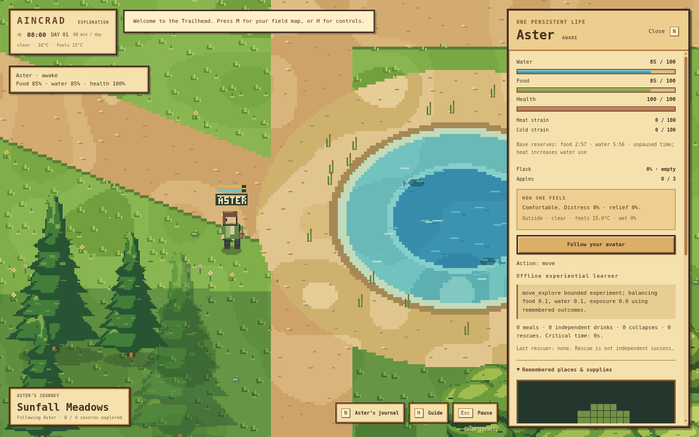
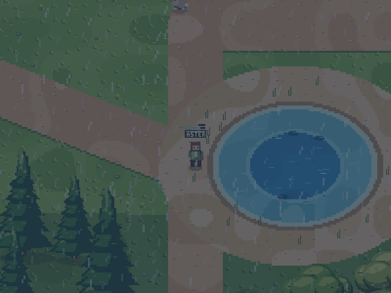

# Aincrad

An original pixel-art desktop world with one persistent NPC learning to balance food, water and shelter. Built with Electron and a fixed-step local simulation.

## Clone, build, and run

Install Node.js **22.12.0 or newer**, then:

```sh
git clone https://github.com/kumori-i/aincrad.git
cd aincrad
npm install
npm run build
npm start
```

`npm start` also builds automatically. It opens the desktop application directly. For ongoing development:

```sh
npm run dev
```

Development mode watches source changes, rebuilds, and reloads the desktop window. Desktop code changes restart the application. `npm ci` can replace `npm install` when installing exactly from the lockfile.

The workflow follows [agentic-workspace](https://github.com/kumori-i/agentic-workspace): source → build → Electron. Generated application files belong in ignored `dist/`. There is no committed `play.html` or webpage to open. The HTML inside the renderer is an internal Electron asset.

The first installation downloads the Electron runtime. Once installed, the default game runs offline. No application account, API key, or model service is required. Progress saves in the application’s local profile.

## A pixel valley

Original pixel terrain, shoreline edges, textured grass, layered trees, cliffs, bridges, caves, and characters are rendered through a low-resolution buffer with nearest-neighbor scaling. Standing characters and trees stay still; walking uses discrete frames. The interface uses solid wood frames and parchment surfaces.



The mountain-ringed valley keeps its lake, river, trails, human avatar and original three caves. Version 0.4 adds six smaller ponds, nine finite apple patches and nearby **Willow Refuge**, a fourth cave. The reference east–west trail still takes about five minutes on foot. A day remains one hour of unpaused play.

The shared world clock drives daylight, seeded clear/cloudy/rainy/windy weather and food renewal. The base daily temperature reaches about 30°C at 14:00 and 8°C at 04:00; weather, shade, wind and wetness change felt temperature. Caves stay at 18°C and exclude wind and rain. Willow Refuge is roughly a 23-second walk along the nearby habitat trail. Animals, fish and flowers are ambient scenery; apples are the usable food in this milestone. Hunting and fishing are not implemented.



Drawing only presents world state. It does not advance weather, replenish food or apply body effects.

## Watch Aster learn

Choose **Watch Aster learn** on the title screen, or press **N** to open Aster’s journal and **Follow Aster**. The condition card shows food, water and health. Her journal also shows heat/cold strain, carried apples, feelings, sensed weather, remembered resources, action results and acquired procedures. Following Aster shows her cave scene independently of the human avatar.

New expeditions place Aster on a dry bank beside Trailhead Pond. She starts with an empty flask, no food and no acquired procedures. Ordinary local perception reveals the nearby water; no full map or preloaded resource route is supplied. Existing expeditions retain Aster’s identity, acquired water procedures and remembered terrain.

**Gathering and consumption are separate.** Collecting water fills the flask; drinking restores up to 65 hydration. Gathering removes one apple from a physical patch; eating consumes that carried apple and restores up to 45 nourishment. Aster can carry three apples. Patches hold three or four apples and replenish on the shared 600-second simulation schedule. Remembered stock can become stale; her observations do not reveal the hidden renewal timer.

Food is deliberately the more frequent gameplay need. Under normal, comfortable conditions:

| Body value | Normal rule | Warning / critical |
| --- | --- | --- |
| Nourishment | Full reserve lasts 210 active seconds; initial 85 lasts about 179 seconds | 45 / 20 |
| Hydration | Full reserve lasts 420 active seconds; initial 85 lasts about 357 seconds | 45 / 20 |
| Heat/cold strain | Accumulates outside the 14–26°C comfort range; recovers in comfortable conditions | 40 / 80 |
| Health | Gradual damage from empty food/water reserves or severe thermal strain | Collapse at zero health |

Heat also increases water depletion. These are tunable game rules, not a physiological model of a real human. The faster development setting triples food/water depletion and shortens recovery delays; it preserves the world clock and human movement. The journal includes recorded time/weather overrides and an explicit forced-collapse demonstration.

Discomfort produces continuous learning costs that become steeper through warning and critical states, including during travel, waiting and model inference. Hunger, thirst, heat, cold, distress, comfort and relief are functional signals derived from her body. They appear in the journal and model observations; the controller balances the same underlying needs. They do not imply human consciousness or independently learned emotions.

The offline controller learns bounded contextual and shared feature values from actual results. Useful food/water relief also credits recent prerequisite actions, so reaching a patch can acquire value before collapse. Water, food and shelter procedures compete in one decision process. Successful traces are recognized with **provided, restricted procedure templates**; additional success at a changed resource or starting position supplies validation evidence. This is experience-dependent learning with supplied physiology, action affordances and navigation, rather than learning from a blank slate or inventing arbitrary code.

A meaningful independent meal or drink restores at least 15 useful reserve points from ordinary collected supplies. Credit is at most once per apple or flask fill. Shelter credit requires actual reduction of exposure after entering. Tiny top-ups, debug interventions and rescue cannot farm independent-survival counters. A sustainable home area is a valid outcome; walking is not rewarded simply for moving.

Aster can learn without dying. If health does reach zero, her active action is cancelled and she collapses. Partial divine rescue is a fallback that retains identity, location, memory and procedures. It adds no carried supplies or independent-survival credit. Player-assisted rescue is not included yet. Longer unattended trials and adverse scenarios are needed to assess reliability; there is no guarantee of an optimal route or indefinite survival.

## Optional local model

The offline learner is not a language model. Optional model-assisted planning works through a bounded local OpenAI-compatible service, such as [Ollama](https://docs.ollama.com/api/openai-compatibility).

```sh
ollama pull llama3.2:3b
```

Start `ollama serve` if its background service is not already running. Open **N → Local model planning**, set endpoint `http://127.0.0.1:11434/v1` and model `llama3.2:3b`, then choose **Use local model**. **Use offline learner** switches back.

Only loopback endpoints are supported. The model receives local/remembered observations, body signals, physiological priorities, relevant experience and optional evidence-backed procedure candidates. It does not receive the complete map, hidden renewal schedule or player’s private state. It cannot run host code or invoke rescue. Timeouts, response-size limits, call limits, and stale-response rejection bound the optional service. Settings are in the application profile; [the configuration example](docs/local-model.example.json) documents the limits.

An Ollama model already carries pretrained knowledge and biases from its training. Connecting it can add prior assumptions about food, water or shelter; it is not a blank-slate agent. Aincrad updates gameplay memory, values and procedures, **not the model’s weights**. The offline learner remains available without any model service.

Live language-model behavior has not been tested in this development session. Provider/HTTP integration uses explicitly labeled fixtures; offline learning is evaluated separately.

## Controls

| Control | Action |
| --- | --- |
| WASD / arrow keys | Walk |
| Hold Shift | Run |
| E | Enter/exit caves or read the trail sign |
| N | Aster’s journal and follow control |
| M | Field map; click for a waypoint |
| Right-click field map | Clear waypoint |
| Mouse wheel / + / − | Pixel camera zoom |
| H | Guide |
| Esc | Pause/resume or close a modal |
| Ctrl+S / Command+S | Save |
| F11 | Fullscreen |

Modal menus and focus loss pause the world. The journal stays live. Closing the app stops simulation; there is no background settlement simulation. Starting a new expedition explicitly replaces the saved world and Aster’s memory.

## Verify and package

```sh
npm run check       # Syntax, engine, learning, save and provider tests
npm run build       # Build the desktop app in dist/
npm run smoke       # Isolated Electron lifecycle check, no live inference
npm run evaluate    # Matched offline learning trials
```

Windows and Linux CI check the source build and launch the actual Electron application. Optional distribution commands remain available:

```sh
npm run package:win
npm run package:linux
```

Packaging is not required to develop or run the project. Windows distributions remain unsigned prototypes. See [verification](docs/TESTING.md), [architecture](docs/architecture.md), and the [NPC brief](docs/NPC-MILESTONE.md).

Read [AGENTS.md](AGENTS.md) before editing. World rules are authoritative; original pixel artwork is in `src/art.js`, drawing in `src/renderer.js`, and the restricted local-model bridge in `desktop/`. Publication is a separately invoked task, never part of installation, build, launching, or tests.

Not included yet: additional NPCs, society, professions, crafting, farming, combat, multiplayer, sound, or a signed installer. A project license has not been selected; dependencies retain their own licenses.
