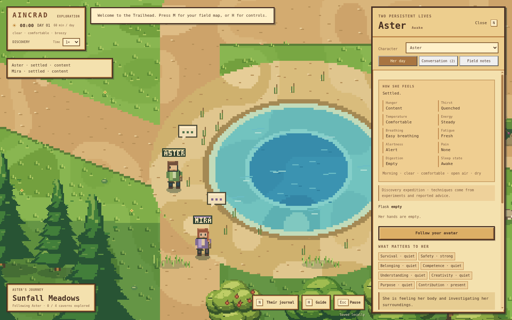
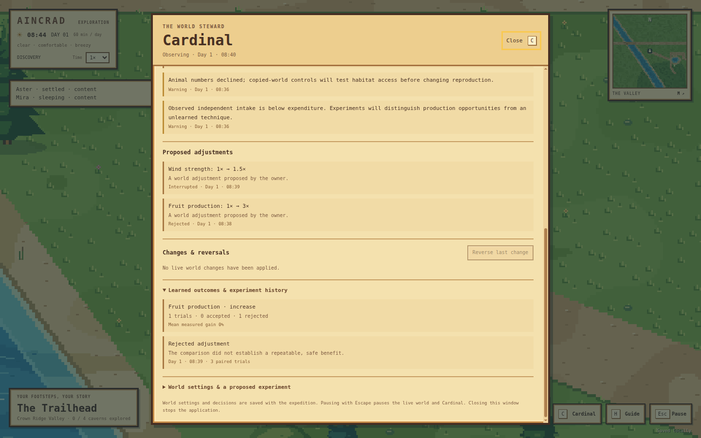
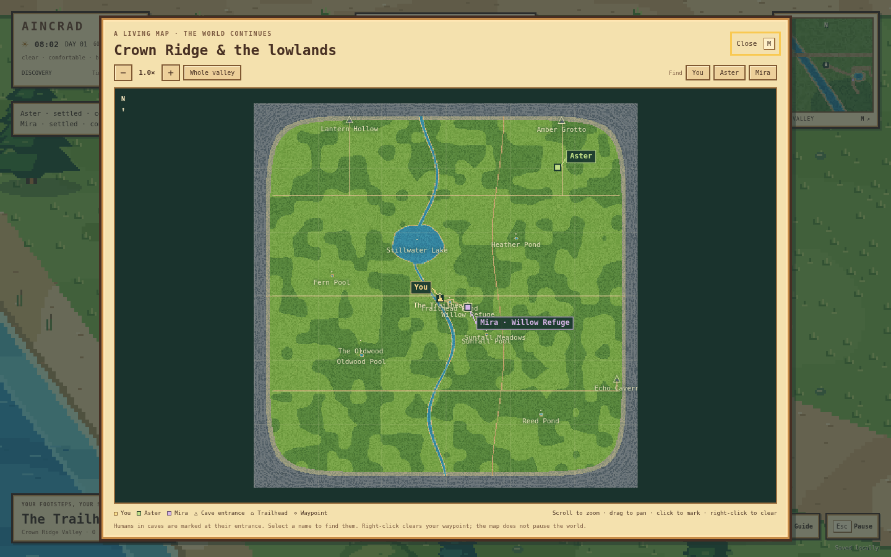

# Aincrad

An original pixel-art desktop world with two persistent characters, **Aster and Mira**, discovering useful actions through experience. Version 0.7 adds **Cardinal**, a persistent world supervisor that observes private simulation measurements, tests environmental changes in copied worlds and adapts the running ecosystem from the measured results.

## Clone, build, and run

Install Node.js **22.12.0 or newer**, then:

```sh
git clone https://github.com/kumori-i/aincrad.git
cd aincrad
npm ci
npm start
```

`npm start` builds and opens the desktop application. For ongoing development use `npm run dev`; it watches source changes, rebuilds and reloads the application. `npm run build` builds independently. The workflow follows [agentic-workspace](https://github.com/kumori-i/agentic-workspace): source → build → Electron. Generated files belong in ignored `dist/`; renderer HTML is an internal application asset, not a webpage to open or deploy.

The first installation downloads Electron. Once installed, the game runs offline without an account, API key or model service. Progress saves in the application's local profile.

## A living pixel valley

Original pixel terrain, shoreline edges, trees, cliffs, bridges, caves and characters use a low-resolution buffer with nearest-neighbor scaling. Idle characters and trees stay still; walking uses discrete frames. The interface uses wood frames and parchment surfaces.



The mountain-ringed valley preserves the human avatar, five-minute reference crossing, lake, river, smaller ponds and four enterable caves. Its saved clock drives daylight, seeded clear/cloudy/rainy/windy weather and seasonal resources. A day lasts one hour at normal simulation speed. Temperature peaks in the early afternoon; wind, rain, shade and wetness affect exposure. Caves provide temperate shelter.

Fresh expeditions use **discovery mode**. Grass, brambles, mature apple trees and animal habitats are distributed across the traversable valley, rather than concentrated around the starting pond. Grass and fruit retain finite biomass and crops. Grazing, picking, detached material and decomposition change the actual saved ecosystem; fruit does not refill on the preceding ten-minute patch timer. Rabbits, bobcats and foxes have simple local survival controllers, species-specific bodies, limited resources and bounded reproduction. Their feeding and pursuit are physical events, not ambient animation. In discovery mode the old decorative animal layer is replaced by the actual ecosystem.

Grass consumers compete for vegetation, predators expend energy pursuing prey, and omnivores have alternatives. Carcasses and spoiled material decompose into the resource cycle. Sleeping creatures are vulnerable to contact and threats. Animal instincts may recognize their species' diet; the human controller does not receive those diet tables.

Fish ecology, deer and larger predators, climbing, tool construction, cooking and cultivation are later milestones. The existing decorative fish in legacy worlds are not a fishing system. This first food web is a configurable simulation, not a calibrated wildlife population model.

## Food discovery rather than supplied recipes

New Aster and Mira begin beside locally observable water with no discovered food techniques. Objects arrive as opaque IDs with locally visible appearance, position, motion and changes. They are not labeled food, edible, prey or nutritious, and hidden species/material data stays in the engine.

The characters have basic bounded object actions such as inspection, grasping, releasing, pulling, sampling and striking. **Foraging and hunting are not starting commands.** The offline discovery controller explores those primitives and records actually executed outcomes. A grasp can establish that an object can be held; it cannot establish that it feeds the body. Sampling is followed by digestion and delayed qualitative feedback. Evidence for a useful material is kept separately from proficiency in manipulating it.

Useful sequences become bounded remembered techniques only after physical practice and measured effects. Proficiency can reduce avoidable time and effort, but does not bypass reach, ownership, available material or minimum physical costs. Repeating an intention, failing at empty resources or describing a successful hunt creates no food or skill credit.

Your journal advice can seed a **reported, unverified hypothesis** about a technique. The initial offline instruction parser recognizes basic manipulation words and an already observed opaque ID or matching visible features, for example `pull object:17 then sample it`. A pronoun can refer to material actually detached by that operation. Ordinary food names do not look up an edible-item table or grant a routine. The character still has to carry out actions and observe consequences. Peer reports and notes remain testimony rather than instant verified facts. A familiar appearance alone does not certify an object's identity or edibility.

Movement, local navigation, water handling, bodily drives, action exploration and qualitative sensation mapping are supplied structure. This is strict experiential **food** discovery, not a blank starting mind, an unconstrained human nervous system or proof of open-ended civilization. A clean discovery experiment uses a new expedition rather than reclassifying old apple routines as self-discovered skills.

## Cardinal: an adaptive world supervisor

Cardinal has full visibility into the simulated bodies, resources, action outcomes and ecosystem budgets. Its authority is separate from the inhabitants' local knowledge. It can change implemented environmental rules and resource conditions through validated engine operations; it cannot quietly teach Aster or Mira a technique, rewrite their memories, heal them or claim an unexecuted action succeeded.

The supervisor records observations, diagnoses bottlenecks and proposes a bounded world adjustment. It compares the unchanged world with that candidate in copied simulations, uses separate training and held-out seeds, and retains the actual outcomes. Accepted adjustments change the running world. Persisted parameter/context scores influence later choices, so its record changes future decisions rather than serving only as a journal of suggestions. Failed candidates remain evidence too. Resource additions are recorded as outside assistance instead of independent ecological production.

Cardinal's objective combines bodily strain, resource balance, acquired practical evidence and ecological condition. It checks for navigation stalls and budget violations so that extra food cannot automatically conceal a broken movement path. A finite experiment is evidence about that snapshot and tested horizon; it is not proof that a change will sustain a civilization indefinitely.

This first implementation runs locally without a language model. Its world control covers implemented, allowlisted actuators with hard physical limits and an intervention history. It does not rewrite executable source, invent mechanics such as fishing, or give itself operating-system access. Those capabilities require a separate development workflow. Cardinal can guide the environment while food discovery remains experiential.

Press **C** to inspect Cardinal's observations, diagnoses, proposals, paired experiments, learned outcomes and world settings. Choose adaptive, observe-only or off; propose a setting for a copied-world test; or reverse the latest eligible intervention. The panel is privileged owner information and does not teach the inhabitants.



| World setting | Valid range |
| --- | --- |
| Plant growth and fruit yield | 0.25–3× |
| Animal foraging range | 0.5–2× |
| Animal reproduction rate | 0–2× |
| Outdoor temperature offset | −6 to +6 °C |
| Rainfall influence | 0–2.5× |
| Wind strength | 0.25–2× |
| Season length | 0.5–2×; owner-requested tests only |

Automatic proposals address intake gaps, depleted producers, dry soil, habitat pressure and thermal exposure. Cardinal can test production, rainfall, foraging range, reproductive pressure, temperature and wind when the corresponding measurements support a hypothesis. A nutrition hypothesis must improve actual intake; unused extra vegetation alone cannot pass as feeding a person.

## Bodies, digestion and sleep

Aster and Mira have independent inventories, sensations, memories and bodies. Normal journal views describe hunger, thirst, discomfort, effort, tiredness and sleepiness in words. Exact reserves and physiological state remain behind developer inspection.

| Internal system | Consequences |
| --- | --- |
| Digestion and stomach contents | Ingested material has delayed effects; handling an object does not feed the body. |
| Available and stored energy | Activity uses immediate energy; longer deprivation consumes reserves and worsens condition. |
| Water balance | Water needs vary with time, exertion and exposure; food may also contribute water. |
| Stamina, fatigue and injury | Effort and harm affect movement and physical attempts. |
| Sleep pressure and daily rhythm | Time awake and time of day influence sleep and alertness. |
| Sleep depth and waking inertia | Restorative sleep limits perception; awakening can leave temporary grogginess. |
| Thermal strain, wetness and health | Exposure accumulates harm; shelter and recovery act over time. |

Discovery physiology uses **game hours and days**, consistently scaled by the simulation clock. Seven days without food and three without water are not fixed death timers. Deprivation and recovery depend on configurable stores, activity, exposure and species profiles. The implementation is approximate game physiology, not medical guidance.

Naps and longer sleep advance the world and continue bodily costs. Sleeping characters do not keep an awake visual feed. Limited sensory disturbance, discomfort or attacks can wake them; waking provides no free energy and severe failure does not guarantee a successful escape. Lost sleep, waking inertia and actual effort affect fatigue. Speed controls let you observe longer biological intervals without making resources or bodies use different clocks.

Collapse and partial divine recovery preserve character identity and memory. Outside assistance does not count as independent self-sufficiency, replenish inventories or manufacture repeated predator meals. No simulation progresses while the application is closed.

## Motives, conversations and knowledge

The concurrent Maslow-inspired drives remain survival, safety, belonging, competence, understanding, creativity, purpose and contribution. Bodily urgency can interrupt exploration or conversation. Beliefs distinguish observation, inference and reported claims; plans and spoken intentions never assign physical success.

Press **N** to open the journal, choose Aster or Mira, inspect her sensations and discovered techniques, or follow her through the valley and caves. Open **Conversation** to send a message to either character or both. You may reply now, later or never; characters continue their own activities. Questions have cooldowns and bounded history rather than a requirement to wait for you.

Local peer speech requires proximity, the same scene and line of sight. It reveals visible activity and reported experience, not private bodies, inventories or memory. Field notes retain authorship and physical locations. Characters must encounter a note to read it; inspecting notes as the human does not remotely deliver them to every character.

Offline dialogue uses supplied language templates grounded in observations and uncertainty. A model can optionally compose human-journal language; its output is labeled separately. These language systems do not demonstrate learned human language or learned model weights.

## Optional local model

The offline discovery learner is not a language model. An optional bounded loopback OpenAI-compatible service, such as [Ollama](https://docs.ollama.com/api/openai-compatibility), can compose human-journal replies and questions in discovery mode.

```sh
ollama pull llama3.2:3b
```

Start `ollama serve` if its background service is not running. Configure endpoint `http://127.0.0.1:11434/v1` and model `llama3.2:3b` in the character journal's local-model controls. This serves both characters; switching to the offline learner disables inference. The model name is an example, not a validated performance recommendation.

**In discovery mode the bridge rejects model-selected physical actions, procedures, plans, peer speech and notes.** Physical experiments come from the experiential controller and explicit human reports. Model-generated text is not treated as human instruction, empirical evidence or a verified technique. Requests include qualitative sensations, sensory objects, executed experience and received journal messages; they exclude hidden nutrition, species/diet tables, body stores and unobserved world state.

Free generated language can still reflect pretrained knowledge; no prompt can establish that a language model has forgotten familiar foods. The separation prevents it from acting as the cold-start physical food oracle. It does not certify all generated sentences as knowledge-free or true. Aincrad updates gameplay memory and values, **not model weights**.

Legacy expeditions retain their preceding optional model action/planning contract. The shared request queue and hourly budget remain bounded, with character-specific cancellation. Failures, stale responses and timeouts leave the offline controller in charge. The model has no operating-system, filesystem, shell, code-execution or rescue access. See [the configuration example](docs/local-model.example.json).

Live model behavior must be evaluated separately from deterministic provider fixtures and offline runs. [Verification](docs/TESTING.md) separates current Cardinal checks from the [historical v0.6 discovery measurements](docs/TESTING-v06.md). Those earlier trials found food discovery but inadequate caloric intake and unstable animal populations; they are not evidence that the new supervisor has solved either problem. Long-term self-sufficiency and ecological stability remain experimental.

## Existing saves and controls

Existing v1–v4 saves remain **legacy expeditions**, preserving identities, progress, memories and the preceding body/food rules. A newly missing second character is added independently. A new expedition uses discovery mode and explicitly replaces the old saved world. Unsupported or damaged saves are reported rather than silently overwritten.

Existing v0.6 discovery expeditions gain Cardinal and missing valley habitats automatically. Migration preserves their people, memories, old object IDs and held material; introduced habitat energy is recorded separately. Legacy expeditions retain their existing physics and observation-only Cardinal.

| Control | Action |
| --- | --- |
| WASD / arrow keys | Walk |
| Hold Shift | Run your avatar |
| E | Enter/exit caves or read the trail sign |
| N | Character journal, follow controls and conversation |
| C | Cardinal observations, experiments, mode and world controls |
| M | Zoomable field map with live Aster/Mira markers; click for a waypoint |
| Drag / wheel / + / − in the map | Pan / zoom the field map; find buttons center a person |
| Right-click field map | Clear waypoint |
| Mouse wheel / + / − | Pixel camera zoom |
| H | Guide |
| Esc | Explicitly pause/resume the simulation |
| Ctrl+S / Command+S | Save |
| Time selector | Shared simulation speed: 1×, 4×, 16× or 60× |
| F11 | Fullscreen |

**The world continues when you click out, hide or minimize the window.** Focus loss clears held movement keys. Opening the map, help or journal does not pause. Escape is the explicit pause control; closing the app stops simulation. Speed changes affect the shared clock consistently, not separate animal, body or plant timers.



## Verify and package

```sh
npm run check       # Syntax, engine, discovery, ecology, save and provider tests
npm run build       # Build the desktop app in dist/
npm run smoke       # Isolated Electron lifecycle check
npm run evaluate    # Offline scenarios; inspect their stated duration and limits
npm run evaluate:cardinal # Actual paired supervisor, adaptation and coverage probes
```

Windows and Linux CI check the source build and launch the actual Electron application. Optional `npm run package:win` and `npm run package:linux` distributions remain available; packaging is not required to run or develop the project. Windows distributions remain unsigned prototypes.

Read [AGENTS.md](AGENTS.md), [architecture](docs/architecture.md), [roadmap](docs/ROADMAP.md) and [verification](docs/TESTING.md) before extending the simulation. Publication is separately invoked and never part of installation, launch or tests. A successful finite run does not establish optimal survival or indefinitely stable ecology.

Motivation draws conceptual inspiration from [AgentCiv's Maslow Machines](https://github.com/agentciv/agentciv/blob/main/paper/maslow_machines.md), knowledge artifacts from [TerraLingua](https://github.com/cognizant-ai-lab/terralingua), and embodied motivation from [MicroPsi](https://github.com/joschabach/micropsi2). The implementation is original; their source and results are not included or assumed to transfer.

Human construction, reproduction, professions, larger societies, multiplayer and sound remain later work. A project license has not been selected; dependencies retain their own licenses.
