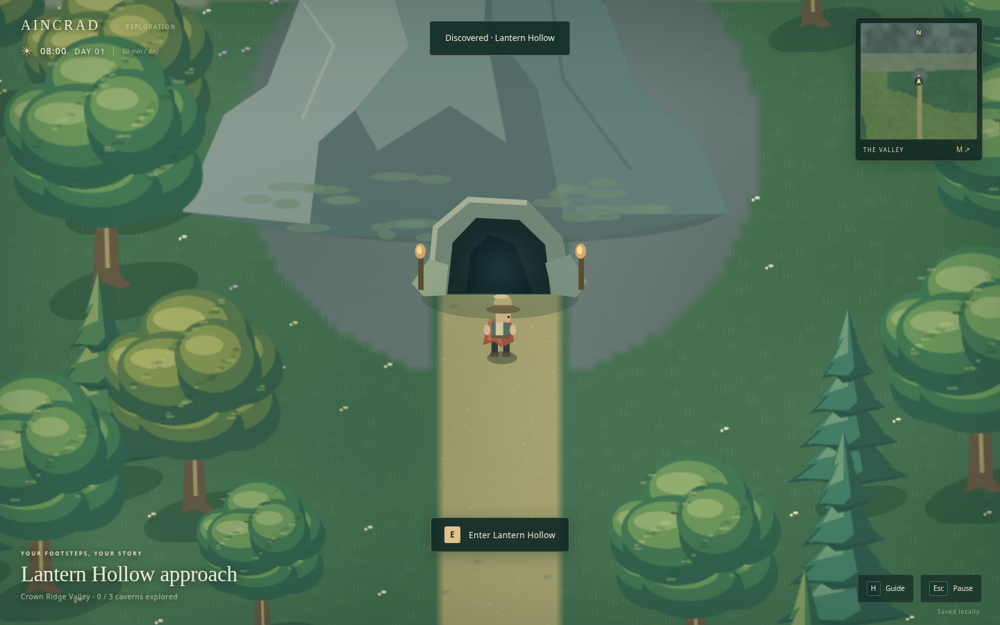

# Aincrad

**A quiet world. Yours to explore.**

A local, single-player exploration prototype: a mountain-ringed valley, a winding river and lake, meadows, trees, three enterable caves, and a human-controlled wanderer. This is the playable world foundation—not an agent demonstration and not a finished survival game.



## Play immediately

Open **`play.html`** in a desktop browser. It is a self-contained build: no account, hosting, internet connection, package installation, or AI service is required to play. Download/extract it before opening; a file-preview pane is not a game runtime.

Browser privacy settings can prevent saving from a `file:` URL. For a stable local origin and normal browser storage, use the local server below. Browser mode and the optional desktop app have separate saves.

## Run from source on your PC

Install Node.js **22.12.0 or newer**, then open a terminal in this folder.

### No-install local browser mode

```sh
npm run web
```

The game opens at `http://127.0.0.1:4173`. Keep the terminal open while playing. Press Ctrl+C to stop it. Only loopback is bound; this does not expose a multiplayer server or your filesystem to the internet. The server serves only the game's explicitly allowed assets.

No `npm install` is needed for this mode. For a different port:

```sh
npm run web -- --port 4174
```

Changing the port changes the browser's storage origin and therefore the save slot. Use the same port to continue an existing expedition.

### Optional standalone desktop window

```sh
npm ci
npm start
```

Electron is an **optional** dependency pinned to `44.7.0`. Its runtime may download on the first launch; internet access is needed for that setup, not for subsequent play. `npm start` uses Electron's CLI to support its lazy runtime download. No browser tab, application login, or API key is needed in desktop mode.

The desktop launcher is included but has **not been run on a physical Windows or macOS machine**. It is not a signed installer. If its optional installation fails, `npm run web` still works. The committed `package-lock.json` pins the desktop dependency tree; use `npm ci` for a reproducible installation. The Linux Electron window has been exercised in a headless test environment.

Press **F11** in desktop mode to toggle fullscreen.

## Controls

| Control | Action |
| --- | --- |
| WASD / arrow keys | Walk |
| Hold Shift | Run, without a stamina limit |
| E | Enter a cave, exit a cave, or read the trail sign |
| M | Open/close the field map |
| Click the world map | Place a waypoint |
| Right-click the world map | Clear the waypoint |
| Mouse wheel / + / − | Zoom |
| H | Open/close the guide |
| Esc | Pause/resume or close an open panel |
| Ctrl+S / Command+S | Save locally |

The map and menus pause the simulation. Losing window focus also pauses. The game does not run an offline simulation while closed or asleep.

## What is in this build

- **A bounded valley:** the impassable Crown Ridge surrounds the walkable world. Mountain peaks are original procedural artwork, not downloaded assets.
- **An actual five-minute reference crossing:** the east–west boundary span is 45,000 logical pixels and walking speed is 150 logical pixels/second. The central trail and its bridge are kept clear. The character's radius reduces the usable span slightly; the automated 300-second movement test reaches the opposite boundary. Detours and diagonal routes differ; sprinting is faster.
- **Water:** Stillwater Lake connects to the Silverrun. Water is solid in this build; three wooden bridges provide crossings. Swimming is not implemented.
- **Meadows and woods:** seeded vegetation, tree/rock collision, shoreline reeds, wildflowers, subtle ripples and butterflies.
- **Three cave entrances:** Lantern Hollow, Amber Grotto, and Echo Cavern. Each opens into a separately visited interior with navigable branching chambers and solid walls, then returns you to its own exterior entrance. The first build reuses the chamber layout with different crystal palettes; they are not three unique dungeon designs yet.
- **A controllable avatar:** animated walking, normalized diagonal movement, collision sliding, running, smooth camera following, and zoom.
- **Navigation:** local minimap, full field atlas, landmarks, cave discovery tracking, and optional waypoints. Waypoint estimates are straight-line walking estimates, not pathfinding.
- **Local persistence:** position, current cave, discoveries, waypoints, and world time. Saves occur about every ten seconds, at transitions, on pause/focus loss, and on explicit save. Invalid coordinates recover to a safe location; unreadable saves are not silently overwritten.
- **A configurable clock:** one in-game day takes one hour of unpaused play. It starts at 08:00 and includes subtle day/evening/night lighting. This clock is already available as a foundation for later gameplay; it does not yet affect survival.

Not implemented: farming actions, resource inventory, construction, needs, NPCs/agents, learning, combat, multiplayer, sound, or background/offline settlement simulation. The camp objects are decorative except for the trail sign.

## Publish to the existing GitHub repository

Target: **[kumori-i/aincrad](https://github.com/kumori-i/aincrad)**, branch **main**.

With Git and GitHub CLI (`gh`) installed, run from this extracted `aincrad` folder:

```sh
gh auth login
npm run publish:github
```

The helper checks the authenticated account and push permission, tests the source, and clones the existing repository into a separate temporary folder. It copies the explicit project file list, commits with your configured Git identity, and performs a normal push to `main`. It does **not** create a repository or change visibility. It never force-pushes, resets another checkout, removes branches, or changes global Git authentication settings.

It will only update the initial README-only commit. If someone has since added different work, it stops before copying files rather than overwriting that work. If these exact files are already published, it exits without another commit. A normal push also rejects concurrent non-fast-forward updates. The temporary checkout is retained on failure for recovery.

Set Git's `user.name` and `user.email` to your own identity if the helper reports that they are missing. Do not put tokens in the game or paste them into chat.

Local-only validation (does not contact GitHub):

```sh
npm run publish:github -- --check-only
```

For a connected GitHub account, prepare the same validated file set with `npm run publish:github -- --prepare-connector ../aincrad-publication.json`. The publisher must verify push permission and the expected branch head in that manifest, create the full tree and commit on top of that head, then update `main` without force. This initial-import helper stops if different work has already been added. For subsequent development, use a regular clone and Git commits.

Run the published project:

```sh
git clone https://github.com/kumori-i/aincrad.git
cd aincrad
npm run web
```

## Water-learning NPC milestone status

The attached NPC specification is preserved in [docs/NPC-MILESTONE.md](docs/NPC-MILESTONE.md), with the project name corrected to Aincrad. **It is a specification, not implemented functionality in this archive.** This recovery build restores and renames the available exploration source; it does not claim to recover the missing NPC implementation from the interrupted attempt. The partially uploaded Git tree was not a complete runnable NPC build.

The renamed application uses its own Aincrad save namespace; it does not delete the old prototype's saves or automatically import them. Browser and desktop saves remain separate.

## Development

```sh
npm run check   # JavaScript syntax validation and the Node test suite
npm run bundle  # Rebuild the self-contained play.html after source edits
npm run web    # Run the modular source directly
```

No transpiler, package manager downloads, game engine installation, or model access is needed for browser development. The renderer uses the browser's Canvas 2D API. Do not edit `play.html` by hand; edit `src/`, `style.css`, or `index.html` and rebuild it.

See [architecture](docs/architecture.md), [verification and limitations](docs/TESTING.md), and [next milestones](docs/ROADMAP.md). Read [AGENTS.md](AGENTS.md) before making changes with a coding assistant.

## Project map

```text
src/config.js       World dimensions, clock, speed, spawn and landmark definitions
src/world.js        Seeded terrain, collisions, movement, cave geometry, time
src/save.js         Bounded save schema and recovery
src/art.js          Original procedural sprites and ground artwork
src/renderer.js     Camera, streamed ground chunks, lighting, maps
src/main.js         Human input, UI, fixed timestep, transitions, save lifecycle
desktop/main.cjs    Optional isolated Electron shell
scripts/           Local server, offline bundle, validation, explicit GitHub helper
tests/             Rules, persistence, server, bundle and optional UI smoke checks
docs/              Design notes, verification record, actual gameplay screenshots
play.html          Generated self-contained playable build
```

The application ships no external artwork, font files, or model weights. A project license has not been selected; choose one before distributing this as an open-source project. Optional dependencies retain their own licenses.
