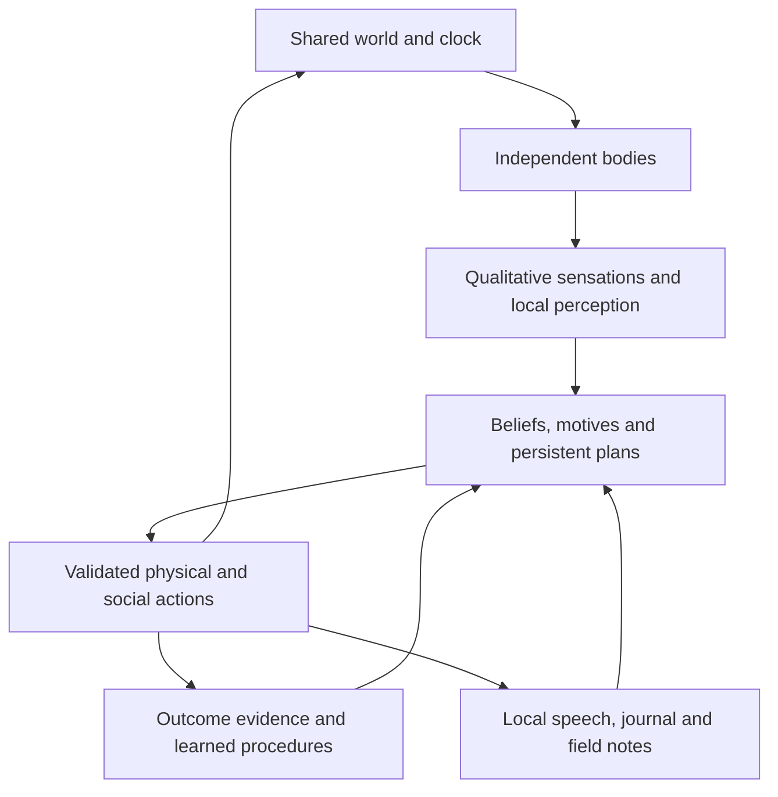

# Aincrad 0.5 architecture

Aincrad is a local-first Electron desktop application with two embodied characters, Aster and Mira, and a human-controlled avatar. Its original pixel world preserves the five-minute reference crossing, one-hour day, weather, finite resources and independent cave transitions.

`npm run dev`, `npm run build` and `npm start` form the source workflow. Builds create ignored files in `dist/`; a strict application protocol serves validated renderer assets. Source HTML is an internal Electron asset, not a browser deliverable.

## Authority and population

`world.js` owns terrain, collision and shared movement. `environment.js` owns seeded weather, daily temperature and finite apple stocks. `npc.js` owns each character's reserves, health, thermal strain, wetness, recovery, inventory, action duration and lifecycle. `config.js` supplies tunable rules. `renderer.js` and `art.js` only present state.

`population.js` owns two independent `NpcController` instances and their shared social coordinator. It advances the environment exactly once per unpaused fixed step, then advances each body/controller. Alternating character order avoids always granting Aster first access to a contested resource. Each gathered apple immediately leaves the shared patch; inventories, memory and decisions remain separate.

NPC and human scenes are independent. Following either character switches the rendered scene and field map to hers. A peer in another cave is not locally visible or reachable. Neither the renderer nor a model response can declare an action completed or assign authoritative body state.

## World knowledge and navigation

Local, unoccluded perception reveals nearby terrain and affordances. The 80-pixel navigation grid covers the character's local view, while remembered cells and blocked edges are stored by scene. `navigation.js` searches observed traversable cells only; interaction points supplement grid centers. Long approaches use bounded moves through known waypoints, and every movement still passes through the authoritative collision rules.

New expeditions begin beside locally observed water, without preloaded procedures or full-map routes. Remembered stock remains stale until observed again. The hidden renewal timer and an unvisited cave's interior conditions are not revealed. Animals, fish and flowers remain ambient scenery rather than additional autonomous minds.

`cognition.js` records bounded beliefs and predictions with source, confidence, status and evidence. Direct observations can verify current resource conditions. Human messages, peer speech and field notes produce reported claims; they do not create discovered resources or traversable routes. Where a report makes a checkable availability claim, later local observation can corroborate or contradict it. Repeat visits can support tentative renewal expectations without exposing the engine's schedule.

## Body and interoception

Exact physiology remains in the engine. Normal full nourishment lasts 210 active seconds and hydration 420 seconds before exposure modifiers; the initial reserves are 85. Food is deliberately the more frequent gameplay need. Apples restore up to 45 nourishment, and a drink up to 65 hydration. Each character carries at most three apples and a separate one-fill flask.

The body also retains independent energy, stamina, fatigue and sleep pressure. Food and meals sustain energy; exertion spends it. Walking consumes stamina and increases fatigue. Idle pauses and timed rest restore stamina, while sleep more strongly relieves fatigue and sleep pressure. Exhaustion slows walking. Rest and sleep never freeze deprivation or exposure; unsafe reserves, strain or health interrupt them. This is a configurable game-body model, not a physiological or neural simulation of a human.

The daily base temperature peaks at 30°C around 14:00 and reaches 8°C around 04:00. Weather, shade, wind and wetness affect felt temperature. Entered caves are insulated at 18°C without rain or wind. Heat/cold strain builds outside the configured comfort range and recovers under comfortable conditions. Empty reserves and severe thermal strain gradually damage health. Zero health triggers collapse.

`interoception.js` maps hidden values to qualitative sensations: hunger, thirst, warmth, energy, breathing effort, fatigue, sleepiness, pain, wetness and relief. `sensedEnvironment` supplies qualitative time of day and weather. Accumulated strain produces overheated or shivering warning cues, distinct from ambient hot/cold and critical danger; a temperate cave does not immediately erase those sensations. Ordinary journal views, decision explanations and model observations use these descriptions. Exact numeric stores are available only through explicit developer inspection. Peer perception exposes visible activity, wetness and expression, never another character's private body or memory.

Continuous bodily risk costs still accrue every fixed step, including while moving, waiting or awaiting model inference. Warning and critical states therefore supply feedback before collapse. The physical engine computes these costs precisely; the agent reasons from felt signals rather than a reserve-percentage dashboard.

## Motivation, learning and planning

The eight concurrent drive records are survival, safety, belonging, competence, understanding, creativity, purpose and contribution. Tensions arise from sensations, carried supplies, elapsed contact, unsuccessful outcomes, new knowledge, notes and an active intention. They are supplied motivational structure. They are not a simulation of human consciousness or a demonstration that civilization has emerged.

The offline controller retains bounded contextual and feature values learned from physical outcomes. Useful relief credits recent successful prerequisites, so navigation and gathering can acquire value before death. Water, food and shelter procedures are recognized through provided, restricted templates with actual evidence. A candidate becomes more reliable through tested successes; repeatedly failing routines can be retired. The controller never invents executable programs.

Persistent plans contain a goal, drive, three to six restricted steps, a cursor, completion and interruption descriptions, travel/return budgets and an outcome history. Steps must match locally known resources or observed traversable targets. Return routes use remembered terrain, and travel estimates can improve from actual completed movement. The offline planner supplies preparation and bounded exploration/return templates; the optional model can propose its own restricted sequence.

A plan advances after real action results. Failure, lifecycle changes, urgent bodily sensations and budget expiry interrupt it. The agent can then address survival or revise its intention. Supplied exploration ranking favors reachable unknown edges and accounts for recent visits and route failures. All fallback searches also remain near remembered supplies and return after a bounded excursion. Felt exertion and observed trips produce conservative travel estimates; longer resource approaches use shorter movements. Warning strain interrupts supply departures, while imminent deprivation can justify leaving shelter. A failed approach does not erase the known refuge, and a bounded movement that made physical progress can continue without marking the resource unavailable. Motion alone receives no reward, and repeating a familiar loop is not new knowledge.

Meaningful independent consumption requires at least 15 useful reserve points from ordinary collected supplies and is counted at most once per apple or flask fill. Shelter evidence requires actual relief after entering. Spoken intentions, questions, notes, debug interventions and rescue do not count as physical survival successes.

## Social channels and knowledge artifacts

`social.js` separates local peer speech from an asynchronous journal room. Peer speech requires both characters to be available in the same scene, within range and line of sight. It records delivered messages, familiarity and reported claims. Cooldowns and duplicate/topic checks limit repeated exchanges. Familiarity does not establish factual truth.

The human can address Aster, Mira or both through the journal regardless of character location. Every observation states that human replies are optional. An unanswered question does not suspend the simulation or impose a wait action. Each character has a bounded pending question and topic history; explicit or targeted replies can answer it. Messages received during sleep or recovery can be read when the character is available again.

The offline controller uses supplied evidence-derived language templates; model-generated language uses the same action authority. Message provenance distinguishes these paths. Dialogue can share something discovered or ask about an uncertainty. The implementation does not treat unrestricted conversation as learned human language or access to another character's whole memory.

Field notes are bounded persistent artifacts with author, location, title, text and optional belief references. A character must encounter a note locally to read it. A received note is testimony, not verified knowledge; rereading does not create repeated discovery credit. The human journal can inspect notes without making their full text globally available to the characters. Notes are data and cannot change resources, physics or executable rules.

## Lifecycle and persistence

`AWAKE → COLLAPSED → RECOVERING → AWAKE` uses simulation time. Collapse cancels active commands but retains identity, map knowledge, experience and procedures. Partial divine rescue is idempotent per collapse, supplies bodily relief without inventory refill, and preserves the scene and safe location. It provides no independent-survival reward.

Game saves migrate versions 1–3 to version 4 using the existing save namespace. Migration preserves Aster and adds an independent Mira. The historical `state.npc` alias refers to Aster in memory; the saved population contains each character once. The selected character, community messages/questions/notes, environment and both bounded bodies, beliefs and plans persist in one allowlisted snapshot.

An unfinished physical action is cancelled on restart; it is not recorded as completed. A retained plan must obtain fresh results for its next step. No wall-clock progression occurs while the application is closed. Unknown fields, invalid identities/coordinates, unbounded histories and executable operations are rejected or recovered. Corrupt/incompatible saves are reported rather than silently overwritten.

## Optional local model bridge

The sandboxed renderer exposes narrow model status, configuration, decision and cancellation methods. Requests are accepted only from the main application frame. The desktop provider validates qualitative body/environment contracts, bounded memories and restricted action/plan JSON before using a loopback OpenAI-compatible service.

The two characters share one queued request service and hourly call budget. Requests carry identity; cancellation can affect one character without cancelling the other's queued work. Timeouts and response limits bound inference. Responses are applied on simulation ticks and rejected when lifecycle or relevant context changes. Urgent sensations can interrupt waiting, with fallback to the offline controller. Service failures remain distinct from gameplay failures.

The Electron renderer retains `nodeIntegration: false`, `contextIsolation: true`, `sandbox: true` and a CSP without renderer network access. The model receives no shell, filesystem, arbitrary IPC or rescue tool. It cannot submit authoritative outcomes or a plan marked already complete. Saves and conversation text remain inert data.

Ollama models bring pretrained knowledge and biases. Aincrad updates gameplay memory, values and procedures, not model weights. Offline behavior, deterministic HTTP/provider fixtures and live-model performance must be evaluated separately. See [TESTING.md](TESTING.md) for actual checks and limits; finite trials do not establish optimality or indefinite survival.

## Conceptual references

The concurrent motives draw inspiration from [AgentCiv's Maslow Machines](https://github.com/agentciv/agentciv/blob/main/paper/maslow_machines.md), persistent shared artifacts from [TerraLingua](https://github.com/cognizant-ai-lab/terralingua), and embodied motivation from [MicroPsi](https://github.com/joschabach/micropsi2). These links attribute ideas; no external implementation source is incorporated. Physical construction, reproduction and larger societies remain later work.
