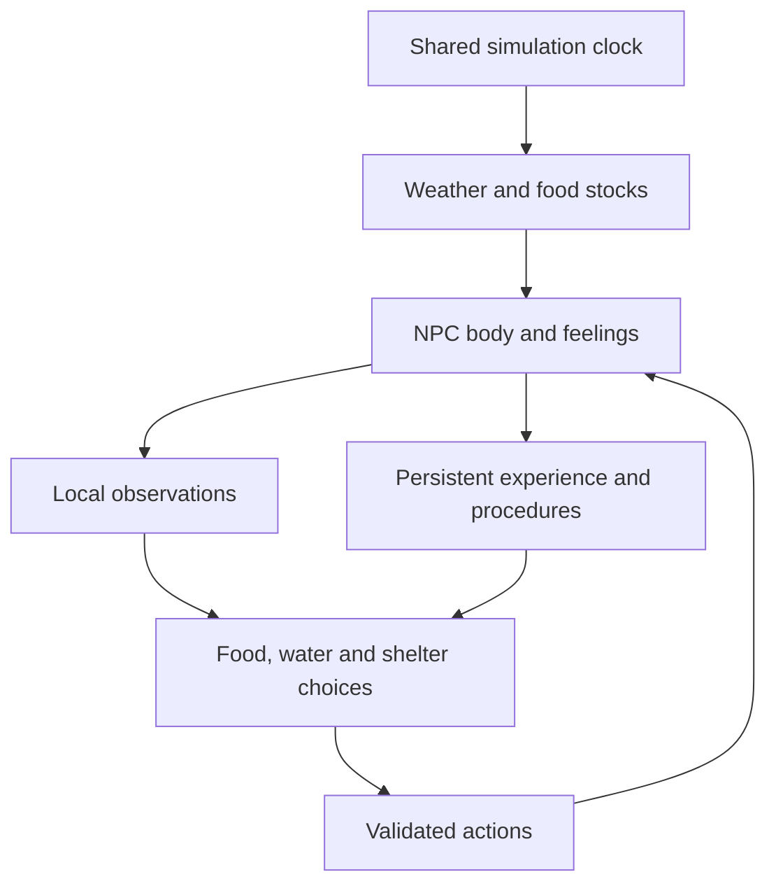

# Aincrad 0.4 architecture

Aincrad is an Electron desktop application with an original pixel-art Canvas world. Rendering uses a low-resolution buffer, nearest-neighbor integer scaling, textured terrain and discrete walking frames. Idle characters and trees are static. The physical world preserves its five-minute reference crossing and one-hour day while adding ponds, apple patches and a nearby refuge.

The source workflow matches `agentic-workspace`: `npm run dev`, `npm run build`, and `npm start`. The build creates ignored desktop and renderer files in `dist/`; Electron serves only validated built renderer assets through its strict application protocol. Source HTML is an internal renderer asset, not a browser deliverable.

## Authority and embodiment

`world.js` owns terrain, collisions and shared movement. `environment.js` owns the seeded weather state, day temperature and finite food-stock renewal. `npc.js` owns body reserves, health, thermal strain, wetness, feelings, inventory, action duration, lifecycle and rescue. `config.js` supplies tunable rules. Controllers submit restricted data; they cannot assign body position, reserves, inventory or successful outcomes. Drawing never advances these rules.

The main loop advances the environment exactly once before the NPC in each unpaused fixed step. Rendering, body sensation, perception and renewal share this saved clock. Pausing freezes them together. Seeded weather selects clear, cloudy, rainy or windy conditions every 180 seconds, with a 20-second transition of wind and temperature effects. The daily base curve peaks at 30°C around 14:00 and reaches 8°C around 04:00. Shade, wind and wetness affect felt temperature. Entered caves are insulated at 18°C with no rain or wind.

Water draw points are generated on accessible lake, river and pond banks. Apples are finite physical stocks in nine patches, each holding three or four items and replenishing every 600 simulation seconds. Gathering removes a stock item and creates a carried apple; eating consumes it. The three-item inventory is separate from the one-fill flask. Animals, fish and plants are deterministic ambient scenery, not additional autonomous agents or food-producing simulations.

Resources enter NPC knowledge only through local, unoccluded perception. New expeditions start on a dry bank beside an ordinarily observed pond. A remembered resource's current stock is not updated remotely; exact future renewal times and an unvisited cave's interior temperature are not supplied. Collapsed NPCs do not refresh perception.

`perception.js` samples an 80-pixel navigation grid within 400 pixels of the body. `navigation.js` searches observed traversable cells only. Observed interaction points are additional navigation nodes when they fall between tile centers. Longer approaches use bounded moves through known waypoints. Each actual movement still uses the same collision-validated `moveActor` as the player. A blocked edge is recorded from an actual failure and subsequent routing can avoid it. No privileged full-map pathfinding is supplied.

NPC and human scene transitions are independent. Aster can enter a locally discovered cave while the player remains in the valley. Cave cells, blocked edges and observed exit affordances are remembered by scene. Following Aster switches the rendered scene and field map to hers.

## Body consequences

Normal full nourishment lasts 210 active seconds and full hydration lasts 420 seconds before heat modifiers; both begin at 85. Warning starts at 45 and critical at 20. Food has the faster depletion and a higher configured urgency weight. Apples restore up to 45 nourishment; a drink restores up to 65 hydration. The accelerated preset triples reserve depletion without changing the day clock or player movement.

Heat/cold strain builds outside the 14–26°C felt comfort range, enters warning at 40 and critical at 80, and recovers at two points per second in comfortable conditions. Rain wets the body; shelter stops rain and accelerates drying. Heat increases hydration depletion. Empty food reserves damage health at 1.2 points per second; empty hydration damages it at two points per second. Thermal damage rises above critical strain to a maximum of one point per second. Damage can combine. Health slowly recovers when needs are safe, and reaching zero health triggers collapse.

`bodyRisk` integrates a continuous cost every fixed step. Costs steepen in warning and critical states and continue while travelling, waiting or awaiting model inference. This creates feedback before death. Feelings are bounded functions of bodily deficits, strain, risk and relief. The UI and optional model receive them; the offline controller prioritizes the same physiology. These are functional state signals, not a claim of conscious emotions.

## Experience-dependent control

The default controller is an offline factored experiential learner, not a language model. It starts with empty resource knowledge and acquired skills, proposes bounded experiments, and updates contextual action values from engine results. Shared feature values for hunger, thirst, exposure, inventory and known resources allow some transfer across contexts without constructing an exhaustive combination table. Exploration ranks observed reachable frontiers and accounts for visits and actual route failures.

Physiology, available actions, navigation, exploration ranking and recognition templates are supplied priors. Learned values adjust a shared food/water/thermal candidate ranking alongside current physiological urgency and travel cost. A learned water procedure has no unconditional priority over food, shelter or an optional model decision. A substantially more urgent need can interrupt an active routine when a useful alternative is available.

Continuous risk costs update active and recent actions with a bounded eligibility window. Useful consumption credits successful recent movement, collection and gathering, with weaker credit farther back. Actual thermal relief after entering a cave credits shelter. Motion alone earns no reward; novelty credit is limited and reduced under bodily distress. Choosing a sustainable home area is allowed.

Successful collection/drinking, gathering/eating and entering/resting traces are recognized with restricted, parameterized water/food/shelter templates. They create candidate procedures with links to authoritative evidence. Additional success at a different resource or starting position validates a candidate for those tested conditions. Failed actions update resource/route knowledge and procedure reliability; repeatedly failing procedures can be retired. The agent does not invent arbitrary programs or execute saved code.

Meaningful independent consumption restores at least 15 useful reserve points from ordinary collected water or food. It is counted at most once per flask fill or carried apple. Shelter evidence requires actual strain reduction after entry. Tiny top-ups, full reserves, debug interventions and rescue cannot farm these counters. Carried-supply provenance and procedure evidence survive bounded history pruning.

Rescue has no positive independent-survival reward. Collapse adds negative feedback and a compact lesson separating verified cause from a hypothesis. The optional model receives relevant lessons and recent evidence. Learning can begin from successful relief and increasing discomfort without any collapse; optimality and indefinite survival are not guaranteed.

## Lifecycle and persistence

`AWAKE → COLLAPSED → RECOVERING → AWAKE` uses simulation time. Collapse cancels an active command but retains identity, experience, map knowledge and acquired procedures. Divine rescue is idempotent per collapse ID, supplies partial bodily relief without adding carried food or filling the flask, and preserves the collapse position or finds a safe adjacent point in the same scene. It is not an agent action. Its presentation can be a benevolent presence or quiet recovery. Player-assisted rescue is not included in 0.4.

Game saves migrate versions 1 and 2 to version 3 while retaining the existing save namespace, identity and acquired water procedures. The whole allowlisted snapshot is written through localStorage as one value. Electron persists it in its application profile. Environment state, food stocks, body state, inventory provenance and scene-specific memory persist together. Collapse/recovery timers survive restart; no elapsed wall-clock simulation is performed while closed. An unfinished command is cancelled once on restart, with a recorded interruption.

Experience, world knowledge, action values and procedures are separate bounded data structures. Unknown fields, executable procedure operations, invalid coordinates and unbounded data are rejected or recovered. Corrupt/incompatible game saves are reported rather than silently overwritten.

## Optional local model bridge

The sandboxed renderer has four narrow methods: model status, configuration, decision and cancellation. Sender frames must be the main `aincrad://app/index.html` frame. The main process stores local model configuration, accepts a bounded observation, calls a loopback OpenAI-compatible endpoint and returns restricted JSON. Body signals, physiological priorities, remembered resources and evidence-backed procedure candidates reach the provider through the same bounded bridge. It supplies no shell, filesystem, arbitrary IPC, credential or rescue tool to the NPC.

The renderer keeps `nodeIntegration: false`, `contextIsolation: true`, `sandbox: true`, and a CSP with no network access. Model requests use explicit timeouts, bounded request/response sizes, no redirects, and hourly call limits. Responses are queued until a simulation tick and rejected after lifecycle/context changes. Service failures are recorded separately from gameplay failures and trigger backoff plus the offline controller.

An Ollama model brings pretrained knowledge and biases. Aincrad does not remove that prior knowledge or update model weights; it changes gameplay memory, bounded values and procedures. This is distinct from offline experiential learning and from model training.

No real language model was available for live verification. Unit tests and desktop HTTP tests use clearly labeled deterministic fixtures. Offline evaluations include normal, hot, cold, depleted-food and unavailable-water conditions and must be assessed with their stated starting conditions and finite durations. They do not establish an optimal policy or unlimited survival. See [TESTING.md](TESTING.md) and [npc-evaluation.json](npc-evaluation.json) for the actual verification record.
