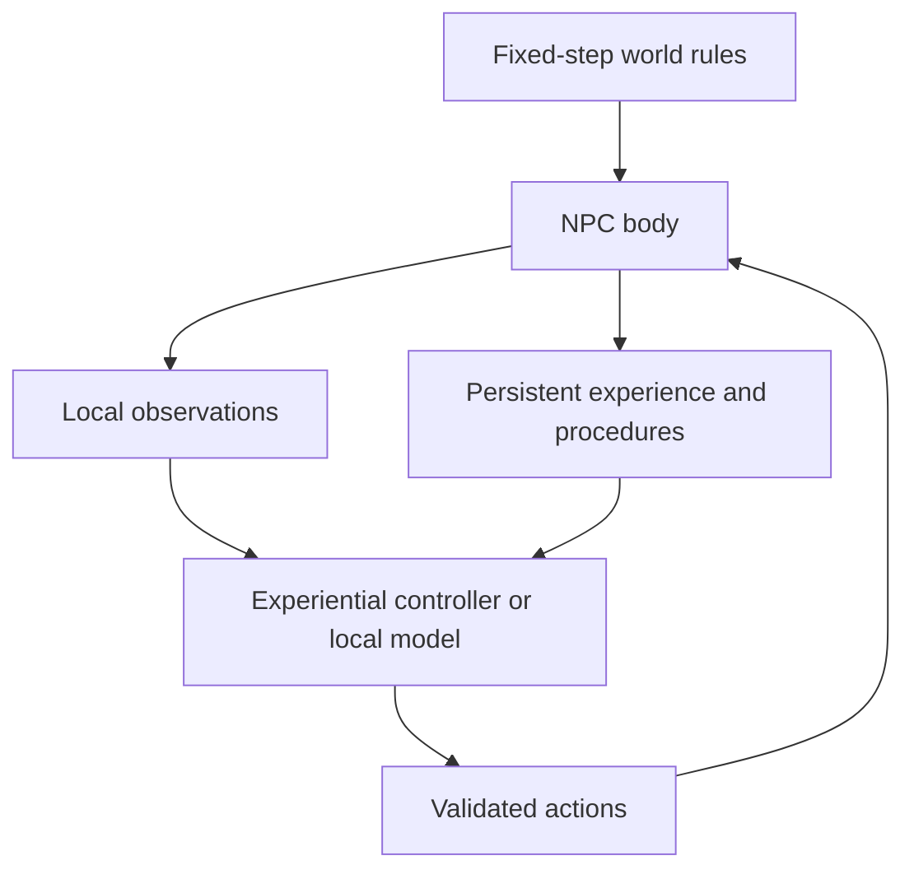

# Aincrad 0.2 architecture

Aincrad is a local Electron application. The renderer remains the original Canvas 2D world, with a procedural pixel character for Aster. The world has not been rebuilt or resized. Its five-minute reference crossing and one-hour day remain intact.

`agentic-workspace` uses an Electron shell with a Phaser pixel-art scene. The same approach is feasible here. This milestone introduces observed navigation tiles independently of the drawing engine; a later Phaser tile/sprite renderer can consume the same authoritative state.

## Authority and embodiment

`world.js` owns terrain, collisions and shared movement. `npc.js` owns hydration, the flask, action duration, lifecycle and rescue. Controllers submit restricted data; they cannot assign body position, hydration, inventory or successful outcomes. Drawing never advances these rules.

Water draw points are generated by the engine on accessible river/lake banks. They enter NPC knowledge only through local, unoccluded perception. An attempted remote interaction does not reveal a remembered source’s current availability. Collapsed NPCs do not refresh perception.

`perception.js` samples an 80-pixel navigation grid within 400 pixels of the body. `navigation.js` searches observed traversable cells only. Observed shoreline interaction points are additional known navigation nodes when they fall between tile centers. Each actual movement still uses the same collision-validated `moveActor` as the player. A blocked edge is recorded from an actual failure and subsequent routing can avoid it. No privileged full-map pathfinding is supplied.

## Experience-dependent control

The default controller is a small offline tabular experiential learner, not a language model or a scripted survival demonstration. It starts with empty source knowledge and skills, proposes bounded experiments, and updates contextual action values from engine results. A seeded exploration helper chooses among observed, low-visit tiles. No water coordinates or complete survival routine are supplied to it.

Successful collection/drinking traces are normalized into restricted, parameterized procedures. A successful trace creates a candidate. Additional success at a different source or starting position validates it for tested conditions. Failure results update resource/route knowledge and procedure reliability; repeatedly failing procedures can be retired. Stored procedure evidence links to retained authoritative event records.

Feedback is used by action-value ranking and procedure selection. Rescue has no positive independent-survival reward. Collapse supplies negative feedback and a compact lesson separating verified facts from a hypothesis. The local model receives these lessons and relevant recent evidence; the offline controller uses the associated value updates and collapse-sensitive ranking.

Meaningful independent drinking is counted once per collected-water fill when it restores at least 15 hydration. Tiny top-ups, full-health drinking and rescue do not farm this counter. Collection has a small bounded value proportional to water actually acquired; exploration credit is bounded.

## Lifecycle and persistence

`AWAKE → COLLAPSED → RECOVERING → AWAKE` uses simulation time. Collapse cancels an active command but retains identity, experience, map knowledge and acquired procedures. Divine rescue is idempotent per collapse ID, restores partial hydration without refilling the flask, and preserves the collapse position or finds a safe adjacent point. It is not an agent action. Its presentation can be a benevolent presence or quiet recovery. Player-assisted rescue is not included in 0.2.

Game saves migrate from version 1 to version 2 and retain the existing save namespace. The whole allowlisted snapshot is written through localStorage as one value. Electron persists this in its application profile. Collapse/recovery timers survive restart; no elapsed wall-clock simulation is performed while closed. An unfinished command is cancelled once on restart, with a recorded interruption.

Experience, world knowledge, action values and procedures are separate bounded data structures. Unknown fields, executable procedure operations, invalid coordinates and unbounded data are rejected or recovered. Corrupt/incompatible game saves are reported rather than silently overwritten.

## Optional local model bridge

The sandboxed renderer has four narrow methods: model status, configuration, decision and cancellation. Sender frames must be the main `aincrad://app/index.html` frame. The main process stores local model configuration, accepts a bounded observation, calls a loopback OpenAI-compatible endpoint and returns restricted JSON. It supplies no shell, filesystem, arbitrary IPC, credential or rescue tool to the NPC.

The renderer keeps `nodeIntegration: false`, `contextIsolation: true`, `sandbox: true`, and a CSP with no network access. Model requests use explicit timeouts, bounded request/response sizes, no redirects, and hourly call limits. Responses are queued until a simulation tick and rejected after lifecycle/context changes. Service failures are recorded separately from gameplay failures and trigger backoff plus the offline controller.

No real language model was available for live verification. Unit tests and the desktop HTTP test use clearly labeled deterministic fixtures. The evaluation uses the offline experiential learner. Neither is presented as live LLM learning.
