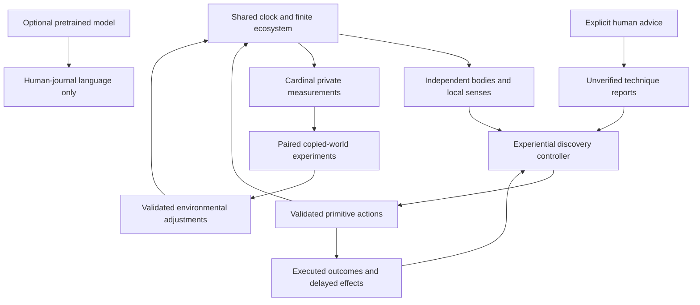

# Aincrad architecture: Cardinal and regional ecology foundation

Aincrad is a local-first Electron desktop application with two embodied characters, Aster and Mira, a human-controlled avatar, a finite food web and the Cardinal world supervisor. It preserves the original valley, five-minute reference crossing, one-hour day, weather and independent cave transitions.

`npm run dev`, `npm run build` and `npm start` form the source workflow. Builds create ignored files in `dist/`; a strict application protocol serves allowlisted renderer assets. HTML is an internal Electron asset, not a browser deliverable.

## Authority and shared time

`world.js` owns terrain, collision and movement. `environment.js` owns the saved clock, weather and environmental conditions. Discovery ecology lives once in `environment.ecology`; `ecology.js` owns plants, animals, detached material, carcasses and decomposition. Legacy worlds retain preceding finite apple patches and renewal rules. `npc.js` owns validated human actions and lifecycle; `biology.js` owns discovery physiology. Config modules hold tunable rules. `renderer.js` and `art.js` draw without advancing them.

`population.js` coordinates two independent controllers and the shared social channel. Every unpaused fixed step advances the environment once, ecology once and each character once. Controller order alternates to avoid permanent first access to shared resources. Plant production, animal movement and consumption, digestion, exposure, sleep and human actions use the same simulation-time increment. Speed controls scale that increment consistently.

Focus loss, hidden state and minimizing do not pause the open application. Held movement keys are cleared on blur. Escape controls the explicit pause state independently of map/help/journal visibility. Closing the application stops progression; reopening does not backfill wall-clock time. The renderer stays passive even when drawing is suppressed in the background.

NPC and human scenes are independent. Following one character changes the rendered scene and field map to hers; it does not move the other actors. Every route and interaction still passes through authoritative collision, position, reach, ownership and available-resource checks.

## Cardinal authority, experiments and adaptation

Cardinal is an engine supervisor rather than another inhabitant controller. It can inspect the complete simulated world, including private physiological stores, actual action failures, held material, species, nutrient budgets and the history of outside assistance. Aster and Mira continue receiving only their local sensory observations and qualitative sensations. Cardinal records do not enter their memories or model prompts.

Saved world rules provide explicit bounded environmental actuators. Runtime operations validate those settings and account for physical resource changes. The supervisor can adjust implemented resource production and ecological conditions; it cannot manufacture skill evidence, set a human's health, erase deprivation, grant inventory items or bypass a physical action. External additions have separate accounting. Full world supervision means authority over the implemented simulation, not arbitrary source execution or permission to corrupt its invariants.

`ecology-regions.js` derives private habitat/climate descriptors and owns regional stock partitioning, validation and soil uptake. `ecology-corridors.js` builds bounded, cached, collision-checked generation/audit paths; it never supplies those paths to controllers or changes terrain. Regional detritus is a partition of the compatibility aggregate, not additional energy counted a second time. Current discovery migration adds no resources or organisms. Existing v3 saves with damaged local metadata are not repartitioned from the aggregate. Normal restoration avoids fresh-world generation.

`cardinal-metrics.js` takes private measurements from actual engine state. The objectives combine bodily strain and deficits, resource condition, acquired empirical capability and ecosystem diversity. Movement stalls and energy-accounting errors are diagnostics/guardrails, rather than reasons to add more food blindly. The objective and proposal policy are supplied design choices, not values discovered by a blank model.

`cardinal-experiments.js` incrementally advances paired sandbox copies of a saved world. A control and a candidate start from the same snapshot and seeded conditions. Only the candidate's validated environmental rule changes; neither branch receives supplied food techniques or fabricated successes. Training pairs and a separate held-out pair yield measured utility differences and explicit adoption/rejection reasons. Sandbox runtimes disable their own Cardinal to prevent recursive intervention. Limited work per live frame keeps the application responsive while a pending experiment makes progress.

`cardinal.js` owns observation cadence, diagnoses, proposals, pending work, outcome records, interventions and parameter/context utility estimates. Later proposals use the persisted estimates, including negative results. Three unsuccessful tests can retire a hypothesis temporarily while other measured problems remain eligible; a game-day retry interval permits later testing under changed conditions. This is a bounded adaptive experiment policy, not LLM fine-tuning or a learned human neural network. A change is applied only after an eligible result; outcomes and reasons remain inspectable. Future evidence can favor different settings, and rollback is an explicit recorded operation rather than erasing intervention history.

The live supervisor and every sandbox use simulation time. Pausing stops live observation and experiment progression; minimizing does not. Copied-world experiments are finite horizons and cannot establish indefinite sustainability or causal understanding beyond the tested difference. Ordinary Cardinal scheduling must remain distinct from any accelerated scheduling used by a developer evaluation.

Automatic runtime control is restricted to existing engine actuators. New executable mechanics, source editing, deployment and operating-system access are not part of this supervisor. Optional future LLM analysis would remain separate from the evidence and physical-application boundary.

## Discovery-mode knowledge boundary

Fresh worlds have `simulationMode:'discovery'`; their NPCs have `mode:'discovery'`. Basic movement, navigation, water handling, body instincts and object manipulation are supplied abilities. Food labels, dietary lists, apple routines, foraging and hunting recipes are not supplied.

`senseEcology` supplies bounded opaque objects with position, visible appearance, motion, sound, quantities and observed changes. It does not reveal species, diet, nutrition, edibility, hidden renewal dates or complete ecosystem state. Scene, local range and occlusion restrict perception. Familiar colors and shapes do not become authoritative object names or food facts.

`discovery-actions.js` executes low-level interactions such as inspection, grasping, releasing, pulling, sampling and striking. Interactions occupy time, expend effort and return physical results. They use `kind:'interaction'` rather than entering the movement-route processor. Discovery humans cannot invoke legacy `gather_food` or `eat` macros. Their carried objects live in `inventory.items`; the sensory observation presents opaque inventory objects rather than an apple counter.

`discovery-state.js` stores bounded observations, actual experiments, experienced effects, practiced techniques and reports. Material-effect confidence is separate from proficiency. A manipulation result establishes only what happened to the object; a later digestion event supplies the evidence for bodily benefit or discomfort. Neither a description nor an intended sequence substitutes for an executed event.

`discovery.js` selects physical experiments from this experience, generic primitives and actual human reports. It does not ask a pretrained model to choose cold-start food actions. A remembered technique requires real practice and evidence; proficiency reduces avoidable time/effort while preserving minimum costs, reach, ownership and finite stock. Empty-resource attempts, repeated words and invalid actions yield no free food, skill or energy.

Reports carry provenance. Explicit human advice can propose a technique as an unverified hypothesis. The initial parser recognizes named generic operations and locally observed opaque IDs or visible feature descriptions; ordinary food names do not resolve through an edible-item dictionary. Material detached by an action has its own ID, and a following held-object operation can retarget to that actual material result. Peer speech and notes are testimony until checked. Model-generated NPC journal text is not an explicit human instruction, own empirical effect or validated technique. Verified outcomes must come from the authoritative engine and experienced consequences.

## Human physiology and sleep

Discovery actors retain projected `hydration`, `nourishment`, `energy`, `stamina`, `fatigue`, `sleepPressure`, `thermal` and `health` fields for existing presentation and explicit developer inspection. Their private `physiology` state owns digestion, immediate/stored energy, water balance, body condition, wakefulness, sleep depth, waking inertia and delayed feedback. Save validation bounds this state; it is never a model or peer observation.

`biology-config.js` scales approximate physiological rates by game hours and days using the configured day length. Seven foodless days and three waterless days are not hardcoded universal collapse deadlines. Activity, exposure, reserves and species profiles alter deterioration. Digestion and longer-term deficits prevent a single meal from instantly repairing accumulated harm. Animals can reuse generic body helpers with different species profiles.

`interoception.js` maps private values to sensations. Discovery adds qualitative digestion (`empty`, `settled`, `full`, `overfull`) and sleep (`awake`, `dozing`, `light sleep`, `deep sleep`, `groggy`) to hunger, thirst, temperature, breathing effort, energy, fatigue, pain and relief. Exact stores, doses and hidden material contents remain private. World time, position and visible discrete quantities may remain numeric because they are not internal body measurements.

Sleep is a timed physical state with onset, depth and a circadian/wakefulness contribution. Sleeping actors lose full visual perception. Limited disturbance, bodily discomfort and contact can cause awakening; waking grants no energy. Waking inertia, missed restorative sleep and actual effort worsen functioning. Naps can provide partial recovery but keep the same vulnerability and continued metabolic/exposure costs. Extremely impaired creatures need not always wake or escape successfully.

The model is configurable gameplay biology, not clinically validated human physiology or a neural simulation. Legacy actors retain the preceding reserve, rest and sleep rules rather than silently changing historical expeditions.

## Finite ecology and survival animals

`ecology-config.js` supplies species and resource rules. Canonical ecology state retains stable opaque IDs, scene/position, plant biomass and seasonal crops, animal bodies, detached material, carcasses, decomposition, birth/death counters and resource budgets. Public sensory objects exclude private species and material metadata.

The first ecosystem contains grass, brambles and existing mature apple trees, with rabbits, bobcats and foxes. Deterministic traversable habitat placement spans the valley instead of only the human starting area. Nearby searches use local candidates rather than granting humans access to the full ecological index. Fruit passes through seasonal growth, availability, detachment and spoilage rather than instant stock refill. Grazing consumes vegetation. Detached plant/animal material decays, and decomposition returns resources to the aggregate nutrient cycle. Reproduction and growth cost resources and obey population bounds.

Animals use deterministic, inexpensive local controllers without an LLM. They seek food/water, flee, pursue, rest and sleep according to species bodies and immediate conditions. Innate animal diet recognition does not enter human observations. Pursuit expends effort and must reach physical contact; failure, injury and flight are possible. Predator threat/contact can wound or wake a human through authoritative callbacks, but cannot silently fill inventories or fabricate human action results.

Divine recovery is external assistance. It must not produce both a recovered character and a reusable corpse on every collapse. Outside rescue energy is counted separately and excluded from ecological self-sufficiency and independent-survival credit. Fish ecology, large predators, climbing, tools, cooking and cultivation are later contracts.

## Motives, memory and plans

The eight concurrent Maslow-inspired drives remain survival, safety, belonging, competence, understanding, creativity, purpose and contribution. They are supplied motivation, not proof of human consciousness or emergent civilization. Bodily urgency can interrupt an experiment, trip or conversation.

Local unoccluded terrain perception builds scene-specific navigation memory. `navigation.js` searches observed traversable cells; it does not query a full map for hidden food. `cognition.js` retains bounded beliefs, uncertainty, provenance, predictions and intentions. A report does not create a resource, route, stock or successful experiment.

Legacy experiential values, supplied procedure templates and three-to-six-step planning remain available in old worlds. Discovery technique records and the strict physical controller are separate: old apple routines are not rebranded as cold-start discovery. Physical plans advance only from actual action results, with failure/urgency/budget interruption; spoken intention never completes a step.

## Social channels and artifacts

`social.js` separates local peer speech from the asynchronous human journal. Nearby speech requires the same scene, range and line of sight, and provides visible appearance plus delivered testimony. It cannot expose private bodily stores or memory. Sleeping/recovering recipients do not receive a full awake visual scene; human messages may be queued until they are available.

The human can address either character or both through the journal. Replies are optional. Pending questions, topic history and cooldowns are bounded; no unanswered message freezes the simulation. Discovery offline dialogue describes recorded experiments, effects and uncertainty instead of supplying apple-is-food templates.

Field notes are persistent authored artifacts with position, scene and optional belief references. A character must encounter a note to read it. A report is not verified by repetition, and rereading produces no repeated discovery credit. The human can inspect notes without granting remote knowledge to the characters. Text remains inert data and never changes physics or executable rules.

## Persistence and compatibility

World snapshots use version 6; discovery NPCs remain version 4. Historical v1–v4 worlds restore as legacy mode, preserving Aster's identity, memory, procedures and prior body/resource rules. Their Cardinal runs in observation mode because adaptive experiments require discovery physics. Existing v5 discovery worlds receive Cardinal and validated default environmental rules automatically; they do not need to discard their characters or restart. Distribution migration supplements missing valley habitats once, accounts for introduced resources as external additions and preserves old object IDs and held material. Mira remains independently initialized where missing. Incompatible saves are not silently deleted or reclassified.

The historical in-memory `state.npc` alias refers to Aster. Canonical disk state stores each agent once, with the selected character, community, environment and its single ecology state. All validators allowlist and bound fields, inventories, object identities, coordinates, physiological histories and experimental records. Saves are data, never programs.

Restart cancels unfinished physical actions without counting them as successes. An unfinished copied-world experiment is marked interrupted rather than assigned a result; Cardinal's completed evidence, utility estimates, settings and intervention history persist. Persisted memories and plans still require fresh authoritative outcomes. Unknown future versions and read errors are surfaced without overwriting the source save. Bodies, ecosystem state, messages, claims, notes and simulation time restart together.

## Optional local model bridge

The sandboxed preload exposes narrow model status, configuration, decision and cancellation methods. Main-process IPC accepts them only from the trusted application frame. Endpoints are loopback OpenAI-compatible services. Request/response size, timeout, shared hourly call budget, one active request and bounded per-character waiting slots limit inference. Cancellation can target one character without cancelling the other.

The bridge branches on explicit observation mode. Legacy observations retain their previous qualitative body/discrete apple schema and validated action/plan contract. Discovery observations contain opaque inventory objects, qualitative body/digestion/sleep, local sensory observations, executed experiments, effects and reported hypotheses. Exact physiology and hidden ecological metadata are rejected even when nested.

**Discovery model output permits only `ask_human` and `journal_reply`.** Physical primitives, movement, food macros, procedures, plans, peer speech and notes are rejected. The prompt asks for grounded language and forbids invented food methods. The physical experiential controller continues independently while a journal response is pending; optional silence, service failure and model budget exhaustion cannot supply an emergency food recipe.

Generated language can still contain pretrained associations or mistakes. Structural action isolation does not prove every sentence knowledge-free or true. Model-origin text stays distinct from actual human advice and measured effects. Aincrad learns gameplay memory and values, not model weights; live-model behavior, scripted HTTP fixtures and offline discovery runs need separate evaluation.

The renderer keeps `nodeIntegration:false`, `contextIsolation:true`, `sandbox:true` and a CSP without renderer network access. Models cannot run shell/code, access files, invoke arbitrary IPC, change permissions, assign body/outcome state or trigger rescue. Text and saves remain inert data. See [TESTING.md](TESTING.md) for completed checks and limits.

## Conceptual references

Motives draw inspiration from [AgentCiv's Maslow Machines](https://github.com/agentciv/agentciv/blob/main/paper/maslow_machines.md), persistent knowledge artifacts from [TerraLingua](https://github.com/cognizant-ai-lab/terralingua), and embodied motivation from [MicroPsi](https://github.com/joschabach/micropsi2). These are conceptual attributions; no external implementation is included and their results are not assumed to transfer.
