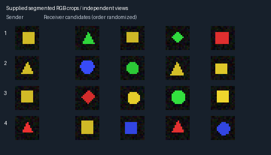

# Offline pixel communication lab

A small, separate research harness: two randomly initialized neural networks try
to refer to the same visible object using two arbitrary symbols. **Nothing here
is wired into the game, Aster, Mira, saves, settings, Ollama or live vision.**
Perfect object segmentation and low-resolution synthetic crops are supplied by
the task, not learned. The result is not English, a language guarantee,
consciousness, full-scene understanding or evidence of compositionality.



These are renderer examples, not learned outputs. No target markings are shown
to either policy.

## Mechanism

The sender's tiny CNN sees only a 16×16 RGB target crop and samples two tokens
from an eight-symbol alphabet. The receiver has a different CNN and sees only
independently rendered candidate crops plus these tokens. It samples one crop.
Both receive 1 for a correct match or 0 otherwise and update with REINFORCE,
using a detached moving reward baseline, Adam and an entropy bonus. There is no
receiver classification-label loss or pretrained/imported semantic encoder.
Environment identifiers stay outside policy inputs. Repeated useful symbol
associations may emerge; a word-like meaning is **measured usage**, never assigned.

See the [measured results](RESULTS.md), [verification boundary](VALIDATION.md),
and predeclared [protocol and acceptance matrix](PROTOCOL.md). The single
failed pilot and all independent main/control attempts must be reported, not
only the best seed. Narrow held-out-pair transfer does not test compositionality:
the four diagonal pairs correlate hue and silhouette, so hue alone could suffice.

## Reproduce locally

Python 3.12 was used. A separate virtual environment is optional at runtime but
recommended for dependency isolation. Installation needs internet once; training
and evaluation are thereafter entirely local/offline. No GPU or model download
is required. Use the official CPU package index to avoid CUDA dependencies:

```sh
python3 -m venv .pixel-lab-venv
.pixel-lab-venv/bin/python -m pip install numpy==2.3.5
.pixel-lab-venv/bin/python -m pip install torch==2.8.0+cpu --index-url https://download.pytorch.org/whl/cpu
.pixel-lab-venv/bin/python -m unittest scripts.pixel_language_lab.test_lab
```

On macOS, use `torch==2.8.0` from the ordinary registry instead of the Linux CPU
wheel command. That environment is not validated by this cloud CPU experiment.
A task-only venv used existing NumPy 2.3.5 and an official 183.9 MB CPU torch
wheel. No game npm dependency or launch path changes.

Keep outputs **outside** `scripts/`, `docs/` and `tests/`: the unmodified repository
publication helper scans those directories even for ignored files. Each output
folder must be new; prior attempts are never overwritten. Example from repo root:

```sh
PY=.pixel-lab-venv/bin/python
OUT=../pixel-lab-runs
for SEED in 17 29 43; do
  "$PY" -m scripts.pixel_language_lab.train --seed "$SEED" --output "$OUT/main-$SEED"
  "$PY" -m scripts.pixel_language_lab.train --seed "$SEED" --control --output "$OUT/control-$SEED"
done
"$PY" -m scripts.pixel_language_lab.evaluate seal --output "$OUT/seal.json" "$OUT"/{main,control}-{17,29,43}/checkpoint.pt
for RUN in "$OUT"/{main,control}-{17,29,43}; do
  "$PY" -m scripts.pixel_language_lab.evaluate run --checkpoint "$RUN/checkpoint.pt" --seal "$OUT/seal.json" --output "$RUN/evaluation"
done
```

The shell expansion above requires Bash. The seal checks all six attempts,
source/protocol/config/split hashes and the fixed training horizon. Failed or
timed-out attempts are included with their actual completed-step count, not
silently omitted. No final evaluation runs before all checkpoints are sealed.
Evaluation runs inference only and checks that model/checkpoint hashes remain
unchanged. Only load trusted local checkpoints; the loader uses torch's
restricted `weights_only=True` mode, not arbitrary pickle execution.

Each run saves model and Adam state, both renderer RNG streams plus selection
and torch RNG, reward baseline, effective config/splits, exact source snapshot,
software versions, elapsed time and termination status. These support diagnostic
replay; the CLI deliberately starts fresh rather than silently resuming. The
compressed evaluation arrays retain per-example targets, candidate types,
messages, shuffle mapping and choices for independent audit. Compact results and
artifact fingerprints belong in Git; checkpoints/raw evidence stay in the
explicit evidence export, not game assets.

## What the controls mean

- **Chance:** 1/K, reported separately for 2, 3 and 4 candidates.
- **Shuffled:** a derangement of messages across the exact same episodes,
  preserving their empirical frequencies; primary test of receiver dependence.
- **Random / zero embedding:** frozen-receiver interventions, potentially
  out-of-distribution, not standalone proof of cooperation.
- **Receiver only:** independently reward-trained under the same budget without
  target-specific communication; tests candidate/target shortcuts.
- **Held-out sets:** fresh IID views, unseen hue/silhouette pairs, unseen nuisance
  backgrounds/translations, and both. These remain synthetic, narrow tests.

Accuracy Wilson intervals are conditional on a trained model. Paired difference
intervals bootstrap episodes and re-derange messages; they are not across-seed
uncertainty. Always show all three seeds and their spread. A failed experiment
can still yield a useful, tested harness without proving communication.
